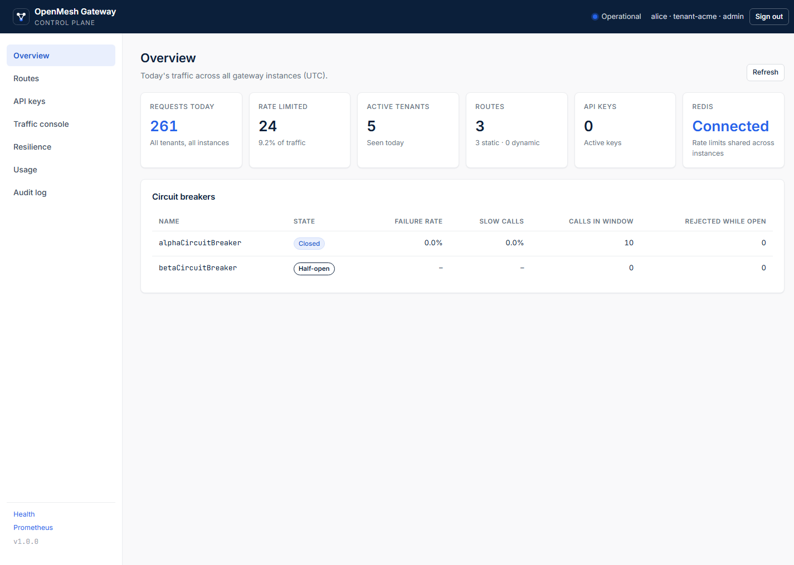
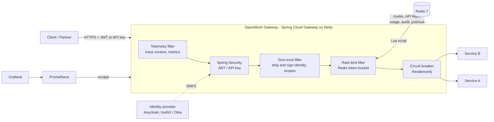
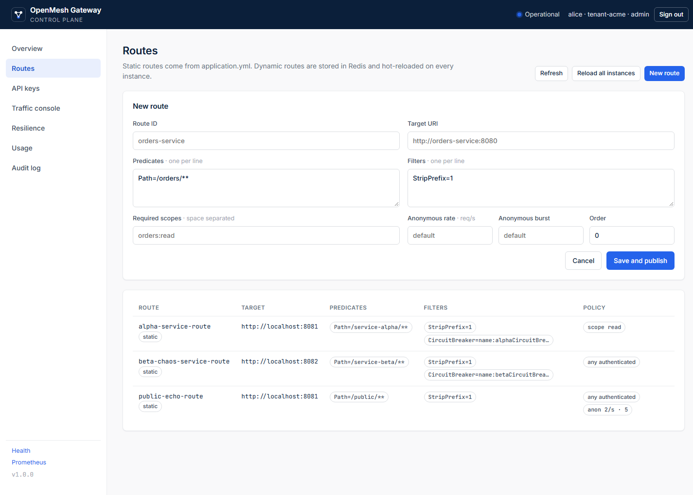

# OpenMesh Gateway

**A cloud-native, multi-tenant API gateway and traffic control plane, built on Spring Cloud Gateway, Netty and Redis.**

OpenMesh Gateway sits in front of your microservices and does what AWS API Gateway, Kong or an Envoy control plane do:
it authenticates every request, enforces per-tenant rate limits shared across a cluster, protects downstream services
with circuit breakers, reloads routes at runtime without restarts, and meters usage per tenant for billing.




---

## Features

| Area | What it does |
|---|---|
| **Zero-trust security** | RS256 JWT validation (signature, expiry, issuer, audience) via a pinned key or any OIDC provider's JWKS endpoint. Caller-supplied identity headers are stripped; the verified identity is forwarded to services and **HMAC-SHA256 signed** so services can prove the request came through the gateway. |
| **API keys** | Machine-to-machine keys (`omk_…`, 256-bit) bound to a tenant, plan tier and scopes. Only the SHA-256 hash is stored; keys are revocable instantly and never forwarded downstream. |
| **Scope-based authorization** | Each route declares `requiredScopes`; callers without them get `403 INSUFFICIENT_SCOPE`. Admin API requires `ROLE_ADMIN`. |
| **Distributed rate limiting** | Atomic token bucket in a Redis Lua script using Redis server time, so limits hold across every gateway instance. Limits follow the tenant's plan (FREE / PRO / ENTERPRISE); anonymous callers are limited per route and client IP. Standard `X-RateLimit-*` and `Retry-After` headers. Configurable fail-open / fail-closed. |
| **Dynamic routing** | Create, update and delete routes through a REST API or the console. Routes are stored in Redis and every instance reloads instantly through Redis Pub/Sub. Input is validated: unknown predicates/filters, SSRF targets (cloud metadata IPs), disallowed schemes and identity-header tampering are rejected. |
| **Resilience** | Resilience4j circuit breakers and time limiters per downstream. Fallbacks return a precise reason: `UPSTREAM_TIMEOUT` (504), `CIRCUIT_OPEN` (503), `UPSTREAM_ERROR` (502). |
| **Usage metering** | Requests and rate-limit rejections per tenant per day, buffered in memory and flushed to Redis in batches (no Redis write on the hot path). CSV export from the console. |
| **Audit log** | Every admin change (routes, API keys) is recorded with actor, action, target and time. |
| **Observability** | Prometheus metrics (throughput, latency histograms, 429s, 5xx) per tenant and route, with cardinality protection. W3C `traceparent` propagation and `X-Trace-Id` / `X-Request-Id` on every response. Grafana dashboard and Prometheus alert rules included. |
| **Admin console (React)** | React 18 + TypeScript single-page app: live traffic charts, route editor, API key management, a Postman-style API explorer, **one-click live demos** that prove each feature end to end, circuit-breaker state machine, usage analytics with CSV export, and an audit timeline. Built into the same jar. |
| **Production ready** | Secure-by-default profiles (startup fails if dev keys or weak secrets are used in `prod`), graceful shutdown, liveness/readiness probes, non-root container, Kubernetes manifests (HPA, PDB, NetworkPolicy), CI with Testcontainers and image scanning. |

## Architecture



**Request pipeline** (in order):

1. `RequestTelemetryWebFilter` starts or continues the W3C trace and adds `X-Trace-Id` / `X-Request-Id`.
2. Spring Security validates the bearer JWT or API key. Admin and actuator paths require `ROLE_ADMIN`.
3. The route is matched (static from `application.yml`, or dynamic from Redis).
4. `ZeroTrustIdentityFilter` builds the tenant context, enforces route scopes, strips spoofed headers and forwards signed identity headers.
5. `TenantRateLimitFilter` checks the tenant's token bucket in Redis and returns `429` when it is empty.
6. The circuit breaker and time limiter call the downstream service, falling back on failure.

## Quick start

**Requirements:** Docker (for the full stack) or Java 21 + Maven + a local Redis.

```bash
# Full demo stack: gateway, Redis, 2 mock services, Prometheus, Grafana
docker compose -f docker/docker-compose.yml up --build
```

| URL | What |
|---|---|
| http://localhost:8080 | Admin console (click **Sign in as administrator**, then open **Live demos**) |
| http://localhost:9090 | Prometheus (alerts under *Alerts*) |
| http://localhost:3000 | Grafana, `admin` / `admin`, dashboard in the *OpenMesh* folder |

Ports and secrets can be changed in `docker/.env` (copy `docker/.env.example`).

**Run from source:**

```bash
docker run -d -p 6379:6379 redis:7-alpine
node docker/mock-downstream/alpha/server.js &   # port 8081
node docker/mock-downstream/beta/server.js &    # port 8082
mvn spring-boot:run -Dspring-boot.run.profiles=dev   # also builds the React console
```

**Work on the console with hot reload:**

```bash
cd frontend
npm install
npm run dev        # http://localhost:5173, proxies API calls to the gateway on :8080
                   # GATEWAY_URL=http://localhost:8090 npm run dev  to target another port
```

**Smoke test** a running gateway: `./scripts/test-gateway.sh` (bash + jq) or `.\scripts\test-gateway.ps1` (PowerShell).

## Try it

```bash
G=http://localhost:8080
TOKEN=$(curl -s -X POST $G/auth/token -H 'Content-Type: application/json' \
  -d '{"tenantId":"tenant-acme","userId":"alice","roles":["ROLE_ADMIN"],"scopes":["read"],"tier":"PRO"}' | jq -r .token)

# Routed call: the downstream echo shows the verified identity and a valid signature
curl -s -H "Authorization: Bearer $TOKEN" -H "X-User-Id: attacker" $G/service-alpha/orders | jq '.identity, .signature'

# Create a route at runtime (all instances reload)
curl -s -X POST $G/admin/v1/routes -H "Authorization: Bearer $TOKEN" -H 'Content-Type: application/json' \
  -d '{"id":"orders","uri":"http://downstream-service-alpha:8081","predicates":["Path=/orders/**"],"filters":["StripPrefix=1"],"metadata":{"requiredScopes":"read"}}'

# Circuit breaker: upstream 500 -> 502, slow upstream -> 504
curl -s -H "Authorization: Bearer $TOKEN" "$G/service-beta/chaos/delay?ms=2500" | jq .reason
```

## Admin console

The console lives in [`frontend/`](frontend/) and is compiled into the gateway jar by `frontend-maven-plugin`,
so there is still a single deployable.

| Page | What it does |
|---|---|
| **Dashboard** | Live requests/s, 429/s and 5xx/s chart (custom SVG), latency, today's totals, busiest routes, breaker health |
| **Live demos** | One-click scenarios that run against the real stack and narrate each step: identity spoofing blocked, rate limit burst, circuit breaker full cycle, route hot-reload timing, API key lifecycle |
| **API explorer** | Send any request with session token, bearer token, API key or no credentials; inspect rate-limit and trace headers; history; copy as cURL |
| **Routes** | Search, create and edit routes in a slide-over editor with server-side validation errors |
| **API keys** | Create (one-time reveal and copy), list and revoke keys |
| **Resilience** | Circuit breaker state machine, failure-rate gauge and a one-click outage simulation |
| **Usage / Audit** | Per-tenant usage with CSV export; audit timeline grouped by day |

**Frontend stack:** React 18, TypeScript (strict), Vite, Tailwind CSS, TanStack Query, React Router (hash routing so the
gateway's path space stays free), Lucide icons, self-hosted Inter / JetBrains Mono, Vitest + Testing Library.
No inline scripts or styles, so it runs under a strict Content-Security-Policy.

| | |
|---|---|
|  |  |
|  |  |

## API

All admin endpoints require a JWT with `ROLE_ADMIN`. Errors use one JSON shape:
`{ status, error, reason, message, path, traceId, retryAfterSeconds, details[] }`.

| Method | Path | Purpose |
|---|---|---|
| `GET` | `/admin/v1/routes` | List static and dynamic routes |
| `GET` | `/admin/v1/routes/{id}` | Get one route |
| `POST` | `/admin/v1/routes` | Create a dynamic route (`409` if it exists) |
| `PUT` | `/admin/v1/routes/{id}` | Create or replace a dynamic route |
| `DELETE` | `/admin/v1/routes/{id}` | Delete a dynamic route (static routes are read-only) |
| `POST` | `/admin/v1/routes/refresh` | Reload routes on every instance |
| `GET` `POST` | `/admin/v1/api-keys` | List / create API keys (plaintext returned once) |
| `DELETE` | `/admin/v1/api-keys/{id}` | Revoke an API key |
| `GET` | `/admin/v1/overview` | Dashboard KPIs, Redis status, circuit breakers |
| `GET` | `/admin/v1/circuit-breakers` | Circuit breaker state and metrics |
| `GET` | `/admin/v1/metrics/live` | Cumulative counters for live charts (requests, 429s, 5xx, latency, top routes) |
| `GET` | `/admin/v1/usage?date=YYYY-MM-DD` | Per-tenant usage for a UTC day |
| `GET` | `/admin/v1/audit?limit=50` | Recent admin actions |
| `POST` | `/auth/token` | Development token issuer (`dev` profile only) |
| `GET` | `/actuator/health/{liveness,readiness}` | Kubernetes probes |
| `GET` | `/actuator/prometheus` | Metrics |

**Route policy** lives in route metadata, for YAML and dynamic routes alike:

```yaml
metadata:
  requiredScopes: "orders:read orders:write"
  rateLimit:
    enabled: true
    replenishRate: 20   # anonymous callers, requests per second
    burstCapacity: 40
```

## Configuration

| Variable | Default | Purpose |
|---|---|---|
| `SPRING_PROFILES_ACTIVE` | none | `dev` for local, `prod` for production |
| `OPENMESH_JWT_JWK_SET_URI` | | JWKS endpoint of your identity provider |
| `OPENMESH_JWT_PUBLIC_KEY_LOCATION` | | PEM public key, if not using JWKS |
| `OPENMESH_JWT_ISSUER` / `_AUDIENCE` | `openmesh-gateway` / none | Expected `iss` / `aud` |
| `OPENMESH_JWT_ROLES_CLAIM` / `_TENANT_CLAIM` | `roles` / `tenant_id` | Claim paths (e.g. `realm_access.roles` for Keycloak) |
| `OPENMESH_IDENTITY_SIGNING_SECRET` | | HMAC secret for downstream identity headers (32+ chars in `prod`) |
| `REDIS_HOST` / `REDIS_PORT` / `REDIS_PASSWORD` / `REDIS_SSL` | `localhost` / `6379` | Redis connection |
| `OPENMESH_RATE_LIMIT_FAIL_OPEN` | `true` | Behaviour when Redis is unreachable |
| `OPENMESH_TRUSTED_PROXY_HOPS` | `0` | Load balancers in front, for correct client IPs |
| `OPENMESH_ROUTE_ALLOWED_HOSTS` | any | Host globs dynamic routes may target, e.g. `*.svc.cluster.local` |

## Testing

```bash
mvn verify      # builds the UI, runs 12 UI tests + 44 backend tests; coverage in target/site/jacoco/index.html
```

* **Unit tests** for every filter, the validator, the rate-limit service, fallbacks, token issuing and signing.
* **Integration tests** start a real Redis 7 with Testcontainers and a mock downstream, then test the whole
  pipeline: security, signed identity, rate limiting with the real Lua script, circuit breaker fallbacks,
  dynamic route lifecycle, API keys, usage metering and audit. They are skipped automatically without Docker.

## Deployment

* `docker/Dockerfile`: multi-stage, layered Spring Boot image, non-root UID 10001, defaults to the `prod` profile.
* `deploy/k8s/`: Kustomize manifests with 3 replicas, rolling updates, probes, HPA, PodDisruptionBudget,
  NetworkPolicy, restricted pod security and a read-only root filesystem. `kubectl apply -k deploy/k8s`
* `.github/workflows/ci.yml`: build, tests, coverage artifact, image build and Trivy scan.

## Project structure

```
frontend/src                       React console
├── pages/        Dashboard, Demos, Explorer, Routes, ApiKeys, Resilience, Usage, Audit, SignIn
├── scenarios/    Live demo scripts and step runner
├── components/   UI kit (buttons, forms, overlays, SVG charts, tables), layout shell
└── lib/          API client, auth, queries, live metrics, formatting
src/main/java/io/openmesh/gateway
├── config/        Security, JWT keys, Redis script, metrics, typed properties
├── controller/    Admin API (routes, API keys, operations), dev token issuer, fallbacks
├── filter/        Telemetry web filter, zero-trust identity filter, tenant rate-limit filter
├── model/         API models, route policy, tenant context, rate-limit tiers
├── repository/    Redis-backed route definition repository
├── security/      API key authentication, HMAC signer, client IP resolver, JSON 401/403
├── service/       Rate limiting, metering, API keys, audit, route validation and broadcast
└── web/           Error format, exception mapping, trace context
src/main/resources
├── scripts/token_bucket.lua   Atomic distributed token bucket
└── application*.yml           Base (prod-safe), dev and prod profiles
```

## Tech stack

Java 21 · Spring Boot 3.3 · Spring Cloud Gateway 4.1 (Netty, Project Reactor) · Spring Security OAuth2 Resource Server ·
Nimbus JOSE + JWT · Redis 7 (Lettuce, Lua, Pub/Sub) · Resilience4j · Micrometer + Prometheus · Grafana ·
JUnit 5, Mockito, Reactor Test, Testcontainers, MockWebServer, JaCoCo · Docker · Kubernetes · GitHub Actions ·
React 18 · TypeScript · Vite · Tailwind CSS · TanStack Query · React Router · Vitest + Testing Library.
